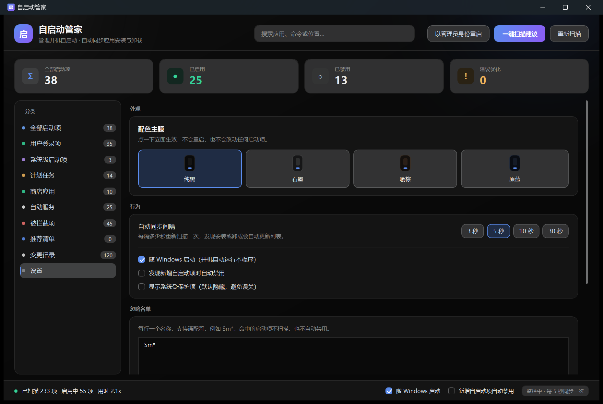

# 自启动管家 · Startup Manager

> Windows 开机自启动的统一管理面板：把注册表 Run、启动文件夹、计划任务、商店应用（UWP）、系统服务、以及被第三方安全软件拦截的启动项，全部收进一个界面里开关；应用安装/卸载后自动同步。

一套 WPF 界面 + PowerShell 5.1 内核，不依赖任何第三方库，双击即用。


## 为什么需要它

Windows 把「开机启动」散落在至少 6 个地方：注册表 Run/RunOnce、启动文件夹、任务计划程序、UWP 启动任务、服务、以及联想/安全软件私有的拦截区。系统自带的「任务管理器 → 启动」只看得到前两类，其余要靠 regedit、taskschd.msc 一个个翻。

自启动管家把它们合并成一张列表，并且：

- 每 5 秒（可调）自动重新扫描，**新装软件自动出现、卸载软件自动消失**，并写入变更记录
- 支持「新发现启动项自动禁用」——适合不想被新软件偷偷加自启的人
- 给出「建议禁用 / 可以禁用 / 看你用不用 / 不建议禁用」的推荐清单，附每个程序是干什么的、禁用的收益与代价

## 功能

| 能力 | 说明 |
| --- | --- |
| 统一列表 | 注册表启动项、启动文件夹、计划任务、商店应用、自动服务、被拦截项，六类来源一处管理 |
| 一键开关 | 走系统原生机制（StartupApproved / Enable-ScheduledTask / UWP State），和任务管理器行为一致 |
| 自动同步 | 定时重扫 + 快照比对，安装/卸载自动反映到列表与「变更记录」 |
| 新项自动禁用 | 可开关；命中的新启动项自动关闭并备份原状态 |
| 推荐清单 | 内置应用知识库，按「建议禁用 / 可以禁用 / 看你用不用 / 不建议禁用」分类，点行看详情 |
| 详情面板 | 这个程序是做什么的、为什么这样建议、禁用之后 vs 保持启用、技术详情（路径/大小/版本/发布者） |
| 被拦截项 | 识别联想电脑管家移到 `Run\LenovoDisabled` 里的启动项，可一键恢复 |
| 每次改动都备份 | 改动前把原状态写入 `backup/`，可回滚 |
| 托盘常驻 + 单实例 | 关窗口不退出；再次双击只唤起已有窗口 |
| 四套配色 | 纯黑 / 石墨 / 暖棕 / 原蓝，设置页里点一下即时切换 |
| 无第三方依赖 | 只用系统自带 .NET Framework 4 + PowerShell 5.1 |

## 快速开始

1. 下载本仓库，放到任意目录（路径可含中文）
2. 双击 **`安装.bat`** —— 在桌面和开始菜单创建快捷方式
3. 双击桌面「自启动管家」开始使用

> **首次启动可能弹「Windows 已保护你的电脑」**：程序是本机用系统自带编译器打包的、没有数字签名，点 **更多信息 → 仍要运行** 即可，只弹一次。不想看到这个提示就用 `启动.vbs` 打开。

不想装快捷方式？直接双击 `自启动管家.exe` 或 `启动.vbs` 也能用。

## 界面

六个分类 + 设置页：

- **全部启动项**：所有可切换项的合集
- **用户登录项 / 系统级启动项**：按作用域分（HKLM、公共启动文件夹属系统级）
- **计划任务 / 商店应用 / 自动服务**：其余三类来源；服务只读展示，避免误停
- **被拦截项**：被联想电脑管家等移入隔离区的启动项
- **推荐清单**：带知识库解释的建议列表
- **变更记录**：最近 120 条新增/移除/状态变化
- **设置**：配色主题、同步间隔、开机自启、自动禁用、显示系统项、忽略名单、数据目录



## 配置

配置文件 `state\config.json`（也可以在设置页里改）：

| 键 | 默认 | 说明 |
| --- | --- | --- |
| `watchSeconds` | 5 | 自动同步间隔（秒），最小 3 |
| `autoDisableNew` | false | 新发现启动项自动禁用 |
| `includeServices` | false | 是否把自动启动的服务并入扫描 |
| `showSystemItems` | false | 是否显示系统受保护项 |
| `ignoreNames` | [] | 忽略名单，支持通配符（如 `Sm*`、`*Updater*`） |
| `theme` | 石墨 | 配色主题：纯黑 / 石墨 / 暖棕 / 原蓝 |

## 备份与回滚

- 每次切换启动项状态前，原状态写入 `backup\<时间戳>-<类型>.jsonl`
- 想手动撤回某一项：在界面里把开关拨回去即可（程序会再记一条变更）
- 大范围回滚：直接用任务管理器 / 系统设置改回，或从 `backup\` 里的记录对照恢复

## 常见问题

**开关点不动 / 提示需要管理员**
该项在 HKLM、公共启动文件夹，或是由安装程序以管理员身份创建的计划任务（任务文件 `C:\Windows\System32\Tasks\...` 当前用户无写权限）。点右上角「以管理员身份重启」。

**为什么有的计划任务标「需管理员」**
程序会实测该任务文件能否被当前用户写入；不能写就标「需管理员」并把详情里的切换按钮隐藏，避免点了没反应。

**服务是灰的**
服务启停 ≠ 登录自启动，程序只读展示，避免误停系统服务。

**列表里没有某个软件**
它可能没设置开机启动，或被安全软件拦到「被拦截项」分类里。

## 技术实现

- **界面**：WPF（XAML 用 `XamlReader::Parse` 动态加载，主题切换靠运行期替换 Brush，因此画刷全部 `po:Freeze="False"`）
- **数据绑定**：所有颜色属性绑 `#RRGGBB` 字符串而非 Brush 对象——PowerShell 创建的 Brush 会在绑定引擎里 `UpdateTargetError` 静默失败
- **开/关注册表启动项**：写 `Explorer\StartupApproved` 的 12 字节值（byte0 = 0x02/0x06 启用、0x01/0x03/0x07 禁用，bytes4–11 为 FILETIME），与任务管理器同一机制
- **计划任务可写性探针**：尝试以写方式打开 `C:\Windows\System32\Tasks\<路径>`，失败即标记「需管理员」——实测与真实权限完全一致
- **计划任务枚举**：优先 COM `Schedule.Service`，失败自动回退 CIM `Get-ScheduledTask`（部分受限上下文里 CIM 会报 `0x80070003`）
- **原生辅助**：DPI 感知与深色标题栏预编译进 `lib\SmNative.dll`，用 `[Assembly]::Load(bytes)` 内存加载，避免受限环境里 `Add-Type` 编译失败
- **exe 启动器**：`src\launcher.cs` 由系统自带 `csc.exe` 编译（`打包exe.bat` 可重新生成），负责单实例唤醒与无窗口拉起

## 目录结构

```
main.ps1              WPF 宿主 + 视图模型
lib\Core.ps1          枚举 / 开关 / 备份 / 快照 / 自启
lib\Advice.ps1        应用知识库与建议推断
lib\SmNative.dll      原生辅助（DPI、深色标题栏）
ui\App.xaml           界面样式与模板
src\launcher.cs       exe 启动器源码
assets\               图标
state\                配置、快照、变更记录、图标缓存（运行时生成）
backup\               改动前备份（运行时生成）
logs\                 运行日志（运行时生成）
安装.bat / 卸载.bat   建/删快捷方式
打包exe.bat           重新编译 exe
启动.vbs              无窗口启动（备用入口）
说明.md               面向使用者的中文说明
```

## 从源码运行 / 重新打包

```bat
:: 直接跑（需要 PowerShell 5.1，Windows 10/11 自带）
启动.bat

:: 重新编译 exe（需要系统自带 csc.exe，通常已随 .NET Framework 4 存在）
打包exe.bat
```

## 已知限制

- 仅支持 Windows 10 / 11
- 非管理员运行时，系统级项（HKLM、公共启动文件夹、部分计划任务）只能查看，不能切换
- 自动启动的服务只读展示
- 被第三方安全软件（如联想电脑管家）拦截的启动项，其隔离区由安全驱动写保护，只能尝试恢复、无法直接删除

## 许可

[MIT](LICENSE)
